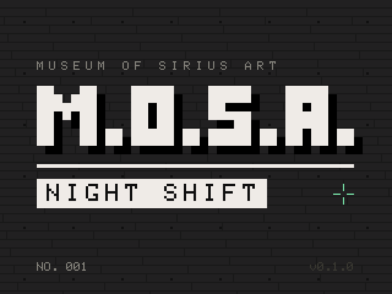
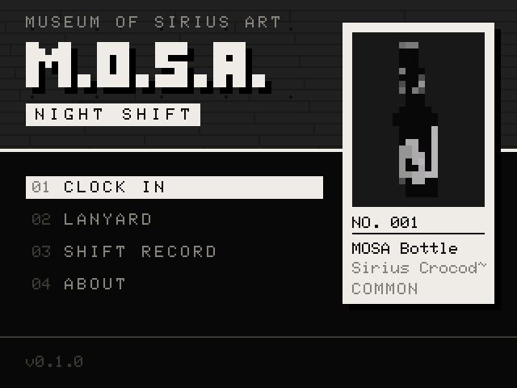
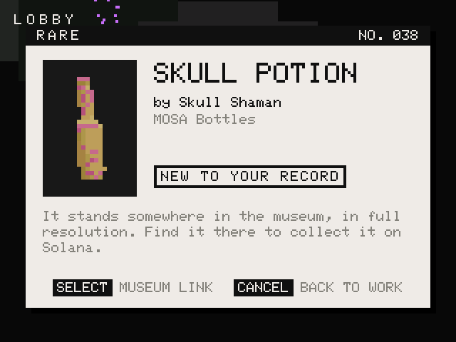
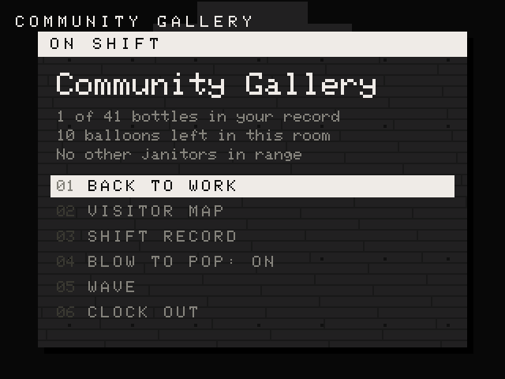
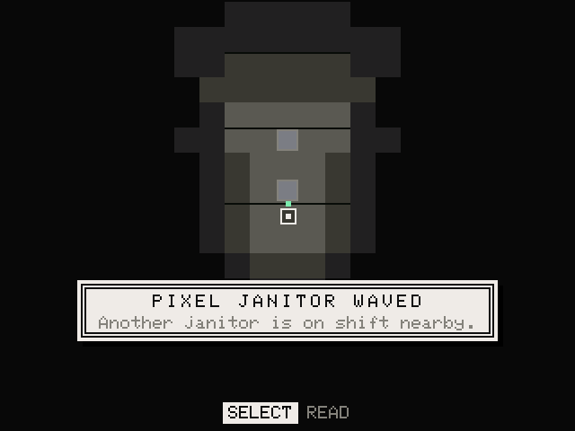
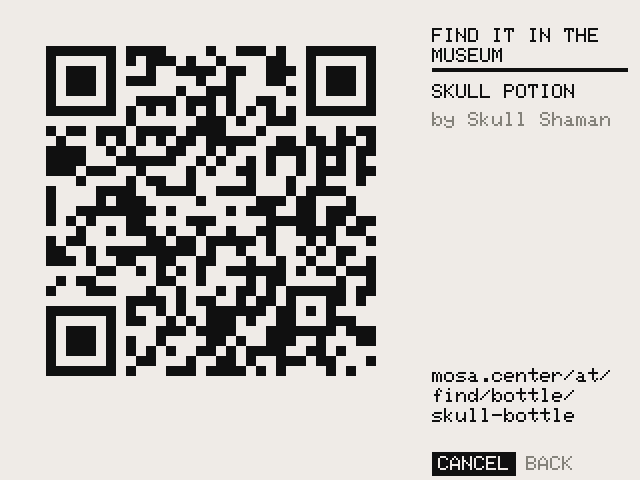

# M.O.S.A. on the Solana badge: Night Shift

A way into [M.O.S.A., the Museum of Sirius Art](https://mosa.center), for the
[Solana DEF CON badge](https://solanadefcon.com/) (ESP32-S3, 320×240, six
buttons, two RGB LEDs, mics, ESP-NOW, a Solana key in a secure element).

**Night Shift** is MOSA after hours, top-down. You're the janitor. The rooms
are MOSA's real floorplans, the bottles in the dark are real pieces from the
live **MOSA Bottles** collection by real artists, and every one you find shows
a QR that takes you to where it stands in the HD museum, to collect it on
Solana. Leave the badge alone and it becomes a walking billboard for the
museum.

| | | |
| --- | --- | --- |
|  |  |  |
|  |  |  |
|  |  |  |

*Screenshots are the real Solana OS emulator's framebuffer (`pnpm preview`).*

## Put it on a badge

**From the App Store** (no cable): open
[solanadefcon.com/store](https://solanadefcon.com/store/), point it at this
repo (or `…/tree/v0.1.0` for a pinned release), pick `mosa.lua`, enter the
badge ID from the badge's *Settings → Identity*, send. The badge asks its
wearer; SELECT installs.

**Over USB/Wi-Fi:** push the `apps/mosa/` directory with Solana OS's
`badge-push.py` (see [docs/RELEASING.md](docs/RELEASING.md)).

**Try it without hardware:** see *Play it locally* below, or send it from the
store to the official [virtual badge](https://solanadefcon.com/badge/), which
registers like a real one.

## Play it locally

```bash
pnpm build
pnpm play            # http://localhost:5317
```

`pnpm play` runs the built app on the real Solana OS emulator (the vendored
`BadgeCore`, the same one the tests and the official virtual badge use), in
real time, and opens a page with the screen and LEDs:

| Key | Badge |
| --- | --- |
| Arrows | D-pad |
| Z or Enter | SELECT |
| X or Esc | CANCEL |
| Hold M | Blow into the mics |

The page can also simulate a janitor nearby (ESP-NOW presence, which lets the
mythical bottle appear), send a wave, relaunch, or clear the record. Run
`pnpm build` in another terminal and the badge relaunches with the new build.
Your shift record survives that, and is kept in `.cache/play-kv.json`.

Three ways to look at the app without hardware, from fastest to most real:

1. `pnpm preview`: screenshots of every screen in `docs/screens/`, scripted.
2. `pnpm play`: play it by hand, locally.
3. The official virtual badge at [solanadefcon.com/badge](https://solanadefcon.com/badge/):
   install from the App Store exactly as a visitor would, from this public repo
   (push first).

None of them predict the ESP32's speed. Test on a real badge before an event.

## Controls

| | |
| --- | --- |
| D-pad | Walk; move through menus |
| SELECT | Pop a balloon in reach; read a plaque; choose |
| CANCEL | Clipboard (pause): visitor map, shift record, wave, clock out |
| Blow into the badge | Pop every balloon in front of you |
| Hold CANCEL 1.5 s | Quit (handled by Solana OS) |

Walk into a bottle to pick it up. The two LEDs blink in the colour of the
nearest bottle, faster as you get closer.

## Develop

Needs Node ≥ 22.18 (24 recommended), pnpm, and a checkout of the MOSA repo for
syncing (default `../mosa`).

```bash
git clone --recurse-submodules <this repo>
pnpm install
pnpm sync       # MOSA → src/data/mosa_data.lua + mosa.lock.json
pnpm build      # src/ → scripts/mosa.lua (store) + apps/mosa/ (push)
pnpm test       # plays the built app on the real Solana OS emulator
pnpm preview    # screenshots of every screen → docs/screens/
pnpm play       # play it in a browser on the emulator
pnpm pixel      # bottle pixel art: sheet | starter | import | check
```

```
src/              the Lua app (modules; data/mosa_data.lua is generated)
scripts/mosa.lua  BUILT: the single file the App Store installs
apps/mosa/        BUILT: the same app as a directory, for badge-push.py
tools/            sync-mosa.mjs, bundle.mjs, preview.mjs, pixel.mjs, play/, lib/ (emulator, pixel, shift decoder)
art/pixel/        hand-made 16x24 bottle sprites (optional per bottle)
test/             QR round-trips through jsQR; app playthroughs on the emulator
vendor/solana-badge  git submodule, pinned: the badge firmware + its emulator
mosa.lock.json    what the data was generated from; the append-only index registry
```

## Docs

- [CONCEPTS.md](docs/CONCEPTS.md): the options considered and why Night Shift first
- [FLOW.md](docs/FLOW.md): from a badge at DEF CON to the HD museum
- [SOLANA.md](docs/SOLANA.md): trust tiers: links, shift claims, booth beacons, badge signatures
- [MOSA-INTEGRATION.md](docs/MOSA-INTEGRATION.md): how the sync keeps us in lockstep, and the museum-side changes
- [PIXEL-ART.md](docs/PIXEL-ART.md): bottle sprites, the rules, the tools, and what AI can and can't do
- [ARCHITECTURE.md](docs/ARCHITECTURE.md): modules, the badge's budgets, 32-bit Lua, the headless badge
- [RELEASING.md](docs/RELEASING.md): versioning and cutting a release
- [CHANGELOG.md](CHANGELOG.md)
