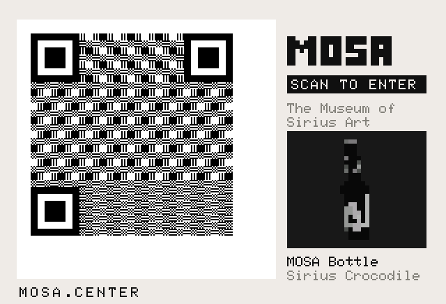

# M.O.S.A. on the Solana badge: Night Shift

A way into [M.O.S.A., the Museum of Sirius Art](https://mosa.center), for the
[Solana Breakpoint 2026 badge](https://solana.com/breakpoint/badge) running
Solana OS (ESP32-C5, a 320×240 screen, six buttons, eight RGB LEDs, a
badge-to-badge mesh).

**Night Shift** is MOSA after hours, top-down. You're the janitor. The rooms
are MOSA's real floorplans, the bottles in the dark are real pieces from the
live **MOSA Bottles** collection by real artists, and every one you find shows
a QR that takes you to where it stands in the HD museum, to collect it on
Solana. Leave the badge alone and it becomes a walking billboard for the
museum.

| | | |
| --- | --- | --- |
|  |  |  |
|  |  |  |
|  |  |  |

*Screenshots come from the headless Solana OS in `tools/lib/host.mjs`
(`pnpm preview`). The firmware draws QR codes itself, so they show as
placeholders here.*

## Put it on a badge

`pnpm build` writes the app package to `apps/mosa/`: `main.lua`, `app.json`
and the modules it `require`s. Open
[solana.com/breakpoint/badge/apps/submit](https://solana.com/breakpoint/badge/apps/submit)
in Chrome or Edge, drop the `apps/mosa` folder on it, plug the badge in over
USB and choose **Run on badge**. **Try in emulator** runs it on the firmware
in your browser instead. The same page submits it to the App Store.

[docs/BADGE.md](docs/BADGE.md) has the details, the serial-console route, and
how to check a build on the real emulator.

## Play it locally

```bash
pnpm build
pnpm play            # http://localhost:5317
```

`pnpm play` runs the built app on the headless Solana OS (`tools/lib/host.mjs`,
the same one the tests use) in real time, and opens a page with the screen and
the eight LEDs:

| Key | Badge |
| --- | --- |
| Arrows | D-pad |
| Z or Enter | SELECT |
| X or Esc | CANCEL |

The page can also simulate a janitor nearby (mesh presence, which lets the
mythical bottle appear), send a wave, relaunch, or clear the record. Run
`pnpm build` in another terminal and the app relaunches with the new build.
Your shift record survives that, and is kept in `.cache/play-storage.lua`.

Three ways to look at the app without hardware, from fastest to most real:

1. `pnpm preview`: screenshots of every screen in `docs/screens/`, scripted.
2. `pnpm play`: play it by hand, locally.
3. The real firmware in WebAssembly, through **Try in emulator** on the submit
   page or the [Solana OS emulator](https://solana.com/breakpoint/badge/emulator)
   (see [docs/BADGE.md](docs/BADGE.md)). This is the one to trust for Lua 5.5
   and API behaviour.

None of them predict the ESP32-C5's speed. Test on a real badge before an event.

## Controls

| | |
| --- | --- |
| D-pad | Walk; move through menus |
| SELECT | Pop a balloon in reach; read a plaque; choose |
| CANCEL | Clipboard (pause): visitor map, shift record, wave, clock out. On the title: leave the app |

Walk into a bottle to pick it up. The LEDs blink in the colour of the
nearest bottle, faster as you get closer.

## Develop

Needs Node ≥ 22.18 (24 recommended), pnpm, and a checkout of the MOSA repo for
syncing (default `../mosa`).

```bash
git clone <this repo>
pnpm install
pnpm sync       # MOSA → src/data/mosa_data.lua + mosa.lock.json
pnpm build      # src/ → apps/mosa/, the Solana OS app package
pnpm test       # plays the built app on the headless Solana OS
pnpm preview    # screenshots of every screen → docs/screens/
pnpm play       # play it in a browser on the headless Solana OS
pnpm pixel      # bottle pixel art: sheet | starter | import | check
```

```
src/              the Lua app (modules; data/mosa_data.lua is generated)
apps/mosa/        BUILT: the app package (main.lua, app.json, modules) Solana OS installs
tools/            sync-mosa.mjs, bundle.mjs, preview.mjs, pixel.mjs, play/, lib/ (host, pixel, shift decoder)
art/pixel/        hand-made 16x24 bottle sprites (optional per bottle)
test/             app playthroughs on the headless Solana OS
mosa.lock.json    what the data was generated from; the append-only index registry
```

## Docs

- [CONCEPTS.md](docs/CONCEPTS.md): the options considered and why Night Shift first
- [FLOW.md](docs/FLOW.md): from a badge at DEF CON to the HD museum
- [SOLANA.md](docs/SOLANA.md): trust tiers: links, shift claims, booth beacons, badge signatures
- [MOSA-INTEGRATION.md](docs/MOSA-INTEGRATION.md): how the sync keeps us in lockstep, and the museum-side changes
- [PIXEL-ART.md](docs/PIXEL-ART.md): bottle sprites, the rules, the tools, and what AI can and can't do
- [BADGE.md](docs/BADGE.md): installing on a badge, and checking a build on the real firmware
- [ARCHITECTURE.md](docs/ARCHITECTURE.md): modules, the badge's budgets, Lua 5.5, the headless badge
- [RELEASING.md](docs/RELEASING.md): versioning and cutting a release
- [CHANGELOG.md](CHANGELOG.md)
