# M.O.S.A. on the Solana badge: Night Shift

A way into [M.O.S.A., the Museum of Sirius Art](https://mosa.center), for the
[Solana Breakpoint 2026 badge](https://solana.com/breakpoint/badge) running
Solana OS (ESP32-C5, a 320×240 screen, six buttons, eight RGB LEDs, a
badge-to-badge mesh).

**Night Shift** is MOSA after hours, top-down. You're the janitor, it's two
minutes to midnight, and three works have gone missing from their walls. Take
the flashlight off its hook and do your rounds: the rooms are MOSA's real
floorplans, and the art on the walls is the art MOSA hangs (Community Gallery,
the Poet Toads show, the Sirials), hung where the HD museum hangs it, as pixel
miniatures. Hold your light on a thief and they drop what they took. Look at
any work up close and a QR takes you to the real one, in full resolution.
The bottles in the dark are real pieces from the live **MOSA Bottles**
collection, lying on the museum's own find spots, each a QR away from being
collected on Solana. Leave the badge alone and it becomes a walking billboard
for the museum.

The night has a clock: 23:41 to dawn, about eight minutes of play. Clear a
break-in and the security desk radios the next, sized to how you're doing;
whatever is still inside at 06:00 leaves with the light. Four kinds of thief
get in (a creep, a statue that poses in your light, a dodger, a swindler with
a dummy), the caught go behind bars, and one of them may flick you a calling
card: work out the room it means and be there to catch the next one in the
act. Every day brings a new night with its own weather (a storm, a full moon,
no moon, a gala) and the same first break-in for every janitor, a streak to
keep, and works and bottles still to find. Recovered works can earn !LAMPs,
the badge's own currency (a build switch, off until the permission is
approved), and once you've worked a night the desk can call you
in the evening when the museum is hit again.

| | | |
| --- | --- | --- |
|  | 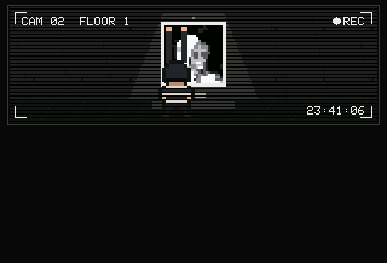 | 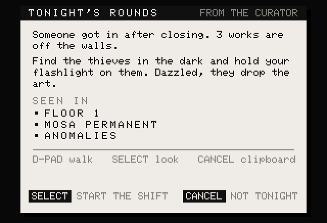 |
| 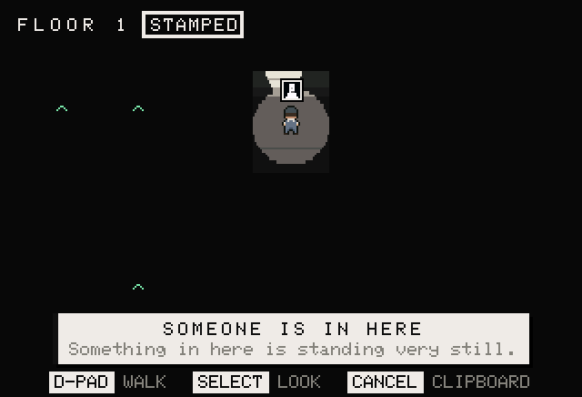 | 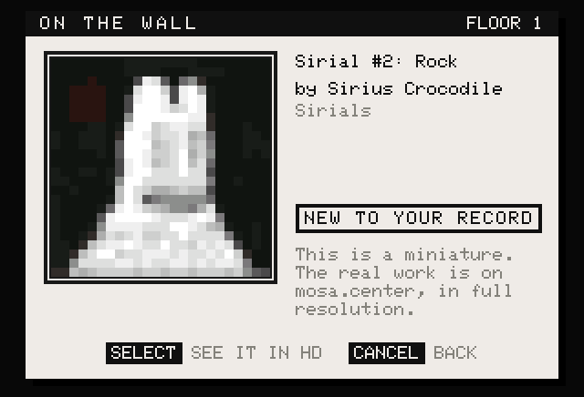 | 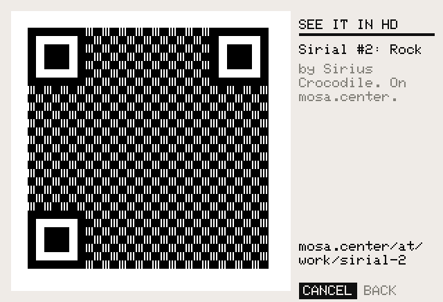 |
| 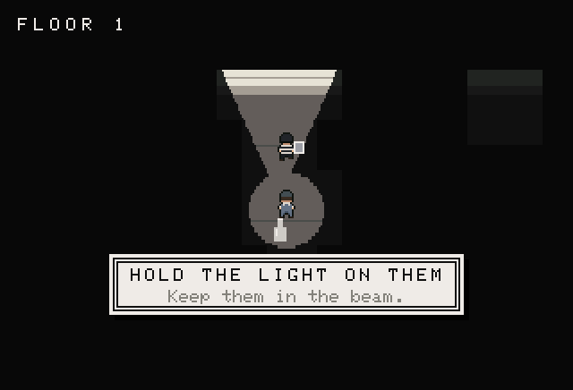 | 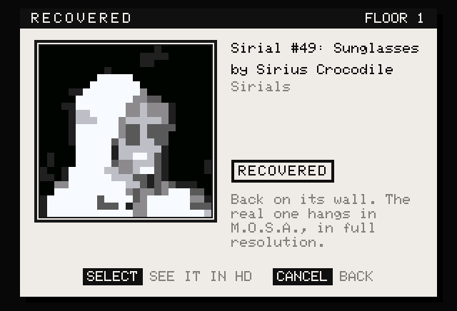 | 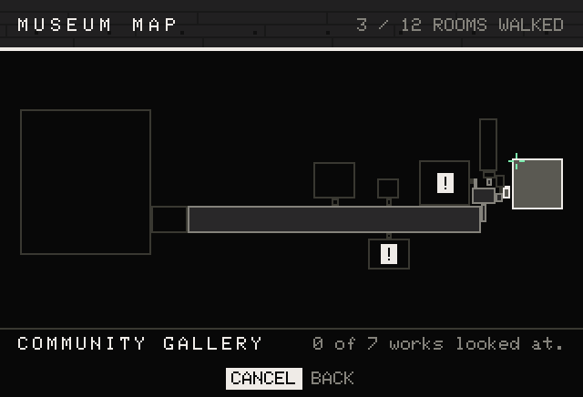 |
| 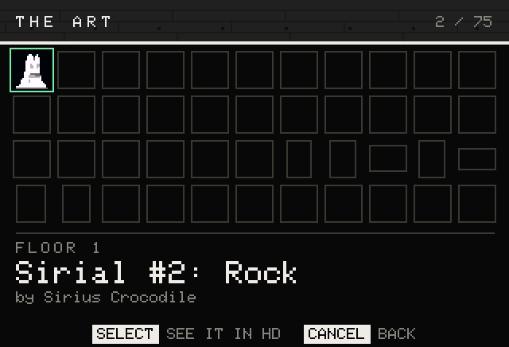 | 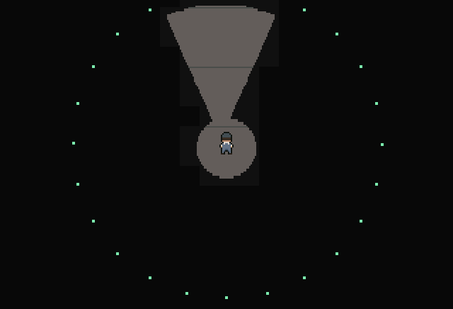 | 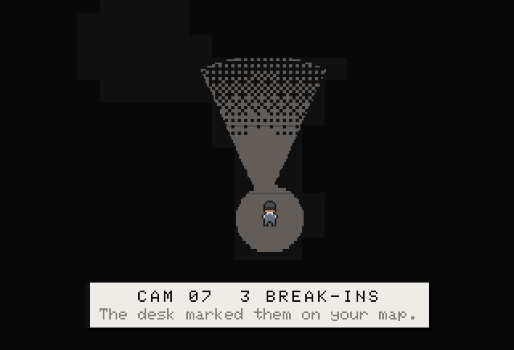 |
| 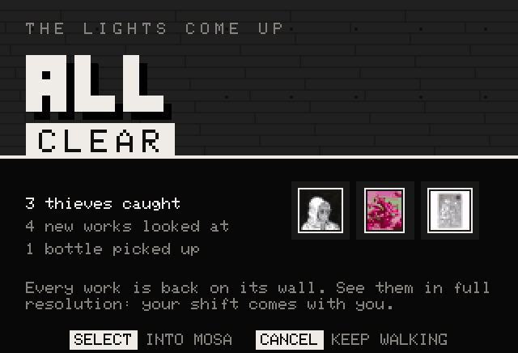 | 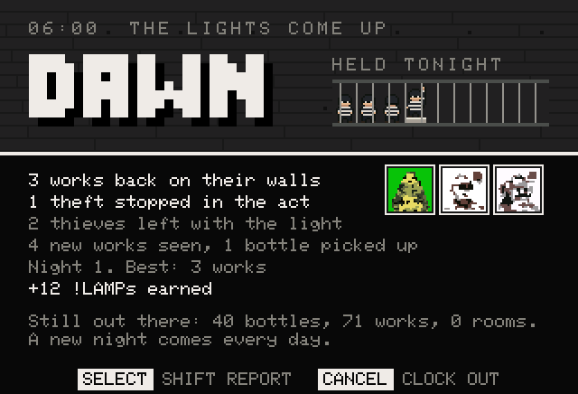 | 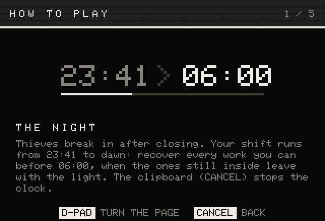 |
| 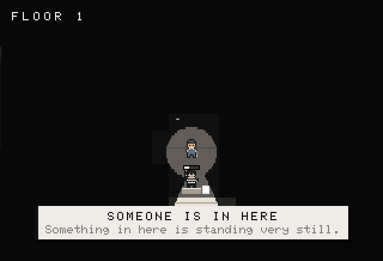 | 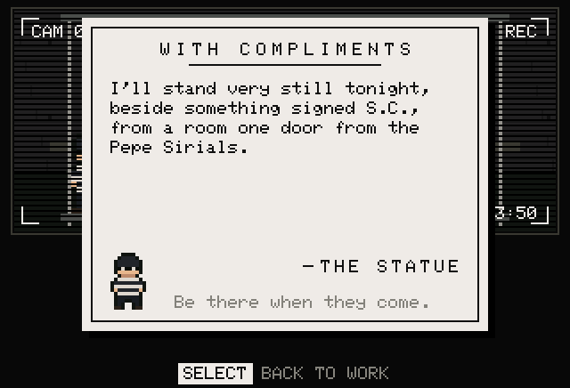 | 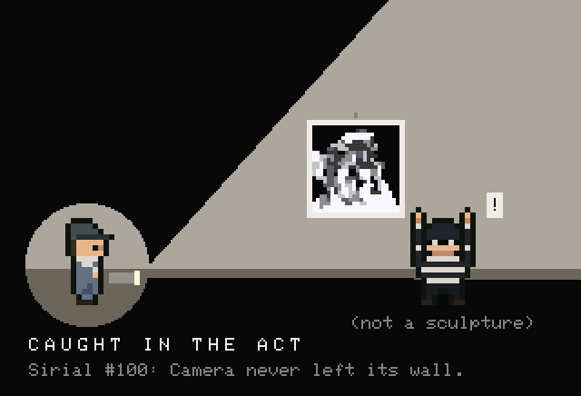 |

*Screenshots come from the headless Solana OS in `tools/lib/host.mjs`
(`pnpm preview`). The firmware draws QR codes itself, so they show as
placeholders here.*

## Put it on a badge

`pnpm build` writes the app package to `apps/mosa/`: `main.lua`, `app.json`
and the modules it `require`s. Open
[solana.com/breakpoint/badge/apps/submit](https://solana.com/breakpoint/badge/apps/submit)
in Chrome or Edge, drop the `apps/mosa` folder on it, plug the badge in over
USB and choose **Run on badge**. **Try in emulator** runs it on the firmware
in your browser instead. The same page submits it to the App Store.

[docs/BADGE.md](docs/BADGE.md) has the details, the serial-console route, and
how to check a build on the real emulator.

## Play it locally

```bash
pnpm build
pnpm play            # http://localhost:5317
```

`pnpm play` runs the built app on the headless Solana OS (`tools/lib/host.mjs`,
the same one the tests use) in real time, and opens a page with the screen and
the eight LEDs:

| Key | Badge |
| --- | --- |
| Arrows | D-pad |
| Z or Enter | SELECT |
| X or Esc | CANCEL |

The page can also simulate a janitor nearby (mesh presence, which lets the
mythical bottle appear), send a wave, relaunch, or clear the record. Run
`pnpm build` in another terminal and the app relaunches with the new build.
Your record survives that, and is kept in `.cache/play-storage.lua`.

Three ways to look at the app without hardware, from fastest to most real:

1. `pnpm preview`: screenshots of every screen in `docs/screens/`, scripted.
2. `pnpm play`: play it by hand, locally.
3. The real firmware in WebAssembly, through **Try in emulator** on the submit
   page or the [Solana OS emulator](https://solana.com/breakpoint/badge/emulator)
   (see [docs/BADGE.md](docs/BADGE.md)). This is the one to trust for Lua 5.5
   and API behaviour.

None of them predict the ESP32-C5's speed. Test on a real badge before an event.

## Controls

| | |
| --- | --- |
| D-pad | Walk; move through menus |
| SELECT | Look at a work up close; choose |
| CANCEL | Clipboard (pause, stops the clock): map and travel, the art, bottles, wave, clock out. On the title: leave the app |

The flashlight points where you walk. Hold it on a thief for a moment and
they drop the work they took; let them reach a door and they get away into
the next room. On the map, SELECT on a room you've walked before travels there,
as in the HD museum, for twenty minutes of the night; doors are free. HOW TO
PLAY on the title has it all in five pages, and [docs/NIGHT.md](docs/NIGHT.md)
says how the night works. Walk into a bottle to pick it up. The LEDs
sweep as you near a thief, and otherwise blink in the colour of the nearest
bottle, faster as you get closer.

## Develop

Needs Node ≥ 22.18 (24 recommended), pnpm, and a checkout of the MOSA repo for
syncing (default `../mosa`).

```bash
git clone <this repo>
pnpm install
pnpm sync       # MOSA → src/data/mosa_data.lua + mosa.lock.json
pnpm build      # src/ → apps/mosa/, the Solana OS app package
pnpm test       # plays the built app on the headless Solana OS
pnpm preview    # screenshots of every screen → docs/screens/
pnpm play       # play it in a browser on the headless Solana OS
pnpm build:web  # a static browser build for the M.O.S.A. arcade cabinet → dist/web/
pnpm pixel      # bottle pixel art: sheet | starter | import | check
```

```
src/              the Lua app (modules; data/mosa_data.lua is generated)
apps/mosa/        BUILT: the app package (main.lua, app.json, modules) Solana OS installs
tools/            sync-mosa.mjs, bundle.mjs, build-web.mjs, preview.mjs, pixel.mjs, play/, web/ (browser host), lib/ (host core + Node host, pixel, shift decoder)
art/pixel/        hand-made 16x24 bottle sprites (optional per bottle)
test/             app playthroughs on the headless Solana OS
mosa.lock.json    what the data was generated from; the append-only index registry
```

## Docs

- [CONCEPTS.md](docs/CONCEPTS.md): the options considered and why Night Shift first
- [NIGHT.md](docs/NIGHT.md): the clock, the desk's waves, dawn, streaks, !LAMPs and the evening call
- [FLOW.md](docs/FLOW.md): from a badge at DEF CON to the HD museum
- [SOLANA.md](docs/SOLANA.md): trust tiers: links, shift claims, booth beacons, badge signatures
- [MOSA-INTEGRATION.md](docs/MOSA-INTEGRATION.md): how the sync keeps us in lockstep, and the museum-side changes
- [PIXEL-ART.md](docs/PIXEL-ART.md): bottle sprites, the rules, the tools, and what AI can and can't do
- [BADGE.md](docs/BADGE.md): installing on a badge, and checking a build on the real firmware
- [ARCHITECTURE.md](docs/ARCHITECTURE.md): modules, the badge's budgets, Lua 5.5, the headless badge
- [RELEASING.md](docs/RELEASING.md): versioning and cutting a release
- [CHANGELOG.md](CHANGELOG.md)
