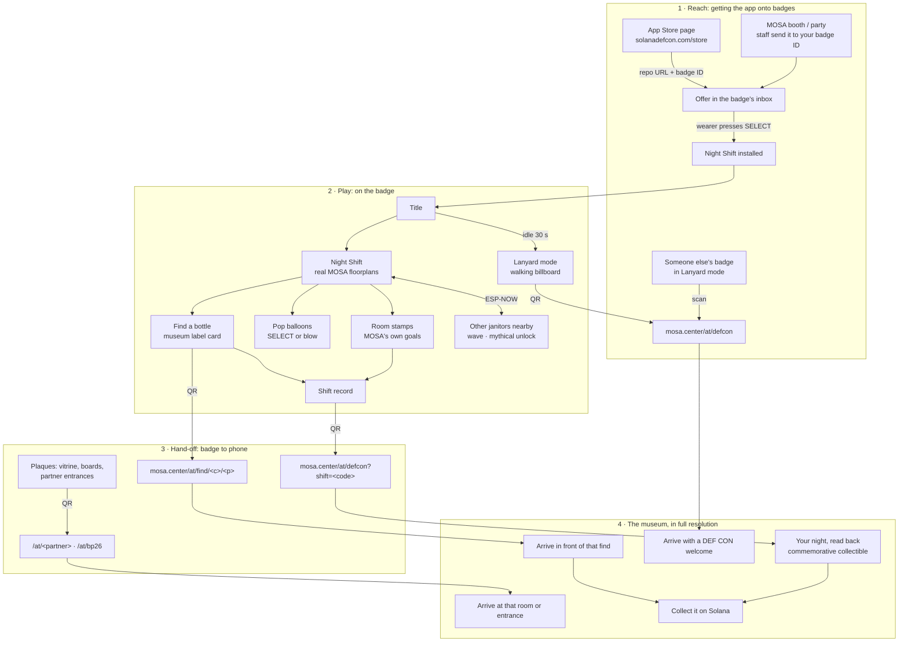

# The flow: from a badge at DEF CON to the HD museum

The badge isn't a smaller museum. It's the door. Each step below either gets
the app onto more badges or moves someone from the badge to `mosa.center` on a
real screen.

## 1. Reach

| Channel | How | Cost to the person |
| --- | --- | --- |
| **App Store** | Paste `github.com/<owner>/mosa-badge` at solanadefcon.com/store, enter a badge ID, send. The badge asks its wearer; SELECT installs. | 10 seconds, no cable |
| **Booth push** | MOSA staff do the above for visitors (badge ID is on Settings → Identity, printed large). A pinned release: `…/mosa-badge/tree/v0.1.0`. | None |
| **Lanyard** | Every installed badge left idle for 30 s shows a scannable MOSA QR and rotating art. Strangers scan the wearer's chest. | None; it's the default idle state |
| **Word of mouth** | ESP-NOW presence: badges with the app see each other. The mythical bottle only appears when two players are near. | Standing next to someone |

The App Store sends **one `.lua` file**, so the whole app (code, floorplans, 41
bottle thumbnails) is bundled into `scripts/mosa.lua` (≈ 83 KB of the 96 KB cap).

## 2. Play

- **Clock in.** You start in the Lobby. The torch lights a few tiles around
  you and a beam ahead; tiles you've seen stay faintly remembered.
- **Sweep.** Bottles from the live MOSA Bottles collection lie where the
  catalogue hunts them (busier rooms in MOSA are messier on the badge). Walk
  into one to pick it up. The two LEDs act as a metal detector: the nearest
  bottle's colour, blinking faster as you close in.
- **Pop.** Balloons drift in every room. SELECT pops one in reach; blowing into
  the badge pops everything in front of you. Some drop a bottle.
- **Stamp.** Entering a room, clearing Floor 1's balloons, finding the
  Crocodile Vault: the same goals as MOSA's room programmes, stamped on the
  badge's Visitor Map.
- **Meet.** Another badge running Night Shift nearby shows up on the pause
  screen. Wave. Work the same room and the mythical may turn up.

## 3. Hand-off

Every surface that names a piece of MOSA offers its link as a QR, dark on
light, sized for a phone at arm's length:

| On the badge | QR target | Exists today? |
| --- | --- | --- |
| A found bottle | `mosa.center/at/find/bottle/<piece>`, MOSA's canonical find link | **Yes**: lands in front of that find |
| Lanyard, About | `mosa.center/at/defcon` | Needs a curated link in the console (Links → New): kind *room* or *entrance*, welcome copy. Until then it opens the Lobby as usual |
| Partner entrance plaque | `mosa.center/at/<partner>` (e.g. `/at/cycol`) | **Yes** |
| Janitor Room plaques | `mosa.center/at/bp26` | **Yes** |
| Shift report | `mosa.center/at/defcon?shift=<code>` | Link works now; reading `shift` is the next museum change |

Every URL the badge prints is checked at sync time with MOSA's own link
parser (`apps/frontend/src/lib/linkPaths.ts`), so the badge can't print a link
the museum doesn't understand.

## 4. The museum

The visitor arrives on a phone or laptop, in the real building, in front of
the thing they found in the dark. From there it's MOSA as usual: walk, look,
pop balloons, collect. The badge's job is done once they arrive.

What the museum can add to close the loop (specified in
[MOSA-INTEGRATION.md](MOSA-INTEGRATION.md)):

1. A `/at/defcon` welcome for badge visitors (console only, no code).
2. Read `?shift=`: "You swept 7 rooms and found 12 bottles on the night
   shift", and offer a free one-per-wallet **Night Shift** commemorative
   collectible through the existing free-find path.
3. Count badge arrivals (the `shift` parameter is the attribution), so we know
   what DEF CON brought in.
