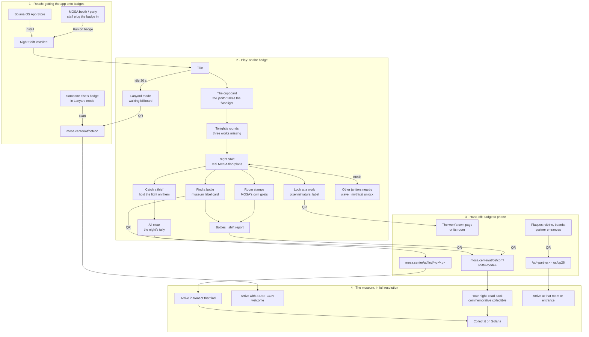

# The flow: from a badge at DEF CON to the HD museum

The badge isn't a smaller museum. It's the door. Each step below either gets
the app onto more badges or moves someone from the badge to `mosa.center` on a
real screen.

## 1. Reach

| Channel | How | Cost to the person |
| --- | --- | --- |
| **App Store** | Night Shift is submitted to the Solana OS App Store; a visitor installs it from the store on their badge. | A minute, no cable |
| **Booth install** | MOSA staff plug a visitor's badge in and use **Run on badge** with a pinned release (see [BADGE.md](BADGE.md)). | None |
| **Lanyard** | Every installed badge left idle for 30 s shows a scannable MOSA QR and rotating art. Strangers scan the wearer's chest. | None; it's the default idle state |
| **Word of mouth** | Mesh presence: badges with the app see each other. The mythical bottle only appears when two players are near. | Standing next to someone |

The App Store installs **one app package**, so the whole app (code, floorplans,
75 works and 41 bottles as pixel art) travels in `apps/mosa/`, with nothing fetched at runtime.

## 2. Play

- **Clock in.** 23:58, the janitor's cupboard. The janitor takes the
  flashlight off its hook and clicks it on; the bulb goes out. The curator's
  note lists tonight's rounds: three works are off their walls, in three
  rooms, the first one door from the Lobby.
- **Rounds.** The flashlight is one hard cone ahead and a small pool at your
  feet; everything else is dark, with a faint memory of what you've seen.
  Exits glow.
- **Look.** The works hang where the HD museum hangs them. SELECT by one
  shows it up close, with its title, artist and room, and **SEE IT IN HD**
  shows the QR to the real work. Everything you've looked at is in THE ART.
- **Catch.** Thieves creep about in the dark. An empty frame tells you what
  was taken. Hold the light on a thief and they drop the work and bolt; the
  LEDs sweep as you close in, and the museum map blinks the rooms they're in.
  Catch all three and the lights come up: **ALL CLEAR**, the night's tally,
  and the shift report one scan away.
- **Sweep.** Bottles from the live MOSA Bottles collection lie on the HD
  museum's find spots, picked as the catalogue hunts them. Walk into one to
  pick it up. The LEDs act as a metal detector: the nearest bottle's colour,
  blinking faster as you close in.
- **Stamp.** Entering a room and finding the Crocodile Vault: the same goals
  as MOSA's room programmes. An uncatalogued room stays off the museum map
  until you find it.
- **Meet.** Another badge running Night Shift nearby shows up on the pause
  screen. Wave. Work the same room and the mythical may turn up.

## 3. Hand-off

Every surface that names a piece of MOSA offers its link as a QR, dark on
light, sized for a phone at arm's length:

| On the badge | QR target | Exists today? |
| --- | --- | --- |
| A found bottle | `mosa.center/at/find/bottle/<piece>`, MOSA's canonical find link | **Yes**: lands in front of that find |
| A work, up close | The work's own link from MOSA's hung-works data (its Mallow or 6529 page); else its room, else `/at/defcon` | **Yes**. Sirials open the museum: MOSA has no per-work link for them yet |
| Lanyard, About | `mosa.center/at/defcon` | Needs a curated link in the console (Links → New): kind *room* or *entrance*, welcome copy. Until then it opens the Lobby as usual |
| Partner entrance plaque | `mosa.center/at/<partner>` (e.g. `/at/cycol`) | **Yes** |
| Janitor Room plaques | `mosa.center/at/bp26` | **Yes** |
| Shift report | `mosa.center/at/defcon?shift=<code>` | Link works now; reading `shift` is the next museum change |

Every URL the badge prints is checked at sync time with MOSA's own link
parser (`apps/frontend/src/lib/linkPaths.ts`), so the badge can't print a link
the museum doesn't understand.

## 4. The museum

The visitor arrives on a phone or laptop, in the real building, in front of
the thing they found in the dark. From there it's MOSA as usual: walk, look,
collect. The badge's job is done once they arrive.

What the museum can add to close the loop (specified in
[MOSA-INTEGRATION.md](MOSA-INTEGRATION.md)):

1. A `/at/defcon` welcome for badge visitors (console only, no code).
2. Read `?shift=`: "You swept 7 rooms and found 12 bottles on the night
   shift", and offer a free one-per-wallet **Night Shift** commemorative
   collectible through the existing free-find path.
3. Count badge arrivals (the `shift` parameter is the attribution), so we know
   what DEF CON brought in.
